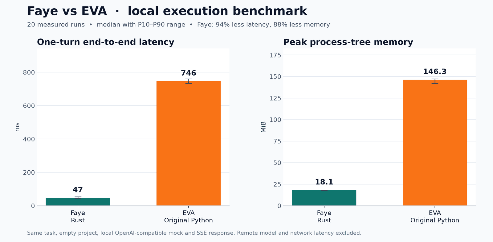

<p align="center"></p>

# Faye

Rust 单文件 Agent。它支持流式思考与回复、Shell 工具、安全审查、目录级会话、记忆压缩和持续执行任务。

基于 [usepr/eva](https://github.com/usepr/eva) 二次开发。

<p align="center"></p>

## 快速开始

### 安装

Linux / macOS：

```sh
curl -fsSL https://raw.githubusercontent.com/tangsong404/tangs-toolbox/main/faye/install.sh | sh
```

安装器会幂等写入 bash 或 zsh 的启动配置，自动把 `~/.local/bin` 加入后续终端的
`PATH`；需要重新打开终端或重新登录后生效。

Windows x64 PowerShell：

```powershell
irm https://raw.githubusercontent.com/tangsong404/tangs-toolbox/main/faye/install.ps1 | iex
```

安装到 `%LOCALAPPDATA%\Faye\bin`，并自动加入当前用户的 `PATH`。重新打开终端后生效。

### 卸载

Linux / macOS：

```sh
curl -fsSL https://raw.githubusercontent.com/tangsong404/tangs-toolbox/main/faye/uninstall.sh | sh
```

默认只删除程序和安装器写入的 `PATH`，保留 `~/.faye` 中的配置、会话与记忆。彻底清理时：

```sh
curl -fsSL https://raw.githubusercontent.com/tangsong404/tangs-toolbox/main/faye/uninstall.sh | sh -s -- --purge
```

Windows x64 PowerShell：

```powershell
irm https://raw.githubusercontent.com/tangsong404/tangs-toolbox/main/faye/uninstall.ps1 | iex
```

默认删除程序及其用户 `PATH` 配置，保留 `%USERPROFILE%\.faye`。彻底清理：

```powershell
$uninstall = irm https://raw.githubusercontent.com/tangsong404/tangs-toolbox/main/faye/uninstall.ps1
& ([scriptblock]::Create($uninstall)) -Purge
```

### 运行

```sh
# 设置模型
faye login

# 持续交互
faye

# 执行一次任务，不读写会话
faye -u "检查当前项目并总结"

# 执行一次任务，并载入、保存当前目录会话
faye -asu "继续上次任务并运行测试"

# goal 模式，持续执行到模型输出完成标记
faye -agu "修复测试并验证，直到完成"

# 跳过命令安全审查和人工确认
faye -a
```

| 参数 | 功能 |
|---|---|
| `-a`, `--allow-all` | 跳过命令审查和人工确认 |
| `-u`, `--user-ask` | 执行一条任务 |
| `-s`, `--with-session` | 单次任务载入并保存当前目录会话 |
| `-g`, `--goal` | 持续执行，直到输出 `__TASK_FINISHED__` |
| `-l`, `--list-session` | 列出所有会话 |
| `-c`, `--clear-session` | 清除当前目录会话 |


### 配置

所有持久化数据统一存放在用户主目录下的 `~/.faye`。

```text
.faye/
├── config.json
├── FAYE.md
├── hints/
│   └── <项目标识>.md
└── sessions/
    └── <项目标识>.json
```

- 配置、会话和记忆不会分散写入各个项目目录。
- `FAYE.md` 用于保存全局规则和长期知识。
- `hints/` 按工作目录隔离记忆线索。
- `sessions/` 按工作目录隔离聊天会话。
- `FAYE_HOME` 可以把整个持久化根目录改到其他位置。

环境变量优先于 `config.json`：

| 环境变量 | 用途 |
|---|---|
| `FAYE_HOME` | 持久化根目录，默认 `~/.faye` |
| `FAYE_API_STYLE` | `chat-completions`、`responses` 或 `anthropic` |
| `FAYE_BASE_URL` | 接口根地址 |
| `FAYE_API_KEY` | API Key |
| `FAYE_MODEL_NAME` | 模型名称 |
| `FAYE_THINKING_EFFORT` | thinking effort |
| `FAYE_SHELL` | 覆盖当前平台使用的 Shell |


## 开发

### 环境

- Rust stable，项目使用 Rust 2024 edition。

### 项目结构

```text
.
├── faye.rs             # CLI、模型协议、Agent 循环、工具和持久化
├── tests/cli.rs        # CLI 与本地模拟服务的集成测试
├── Cargo.toml          # 依赖、二进制目标和 release 配置
├── Cargo.lock          # 锁定依赖版本
├── build.rs            # 平台资源与可执行文件元数据
└── assets/             # 图标和文档图片
```

### 本地构建

```sh
cargo build --locked
cargo run --locked -- login
cargo run --locked
```

生成 release 二进制：

```sh
cargo build --release --locked
```

release 产物位于 `target/release/`，文件名和扩展名由目标平台决定。

### 验证

提交修改前执行：

```sh
cargo fmt --check
cargo clippy --all-targets --locked -- -D warnings
cargo test --locked
cargo build --release --locked
```

### 许可

项目代码采用 MIT License。
项目图标图片资源归原作者所有，不包含在 MIT 软件许可中。
